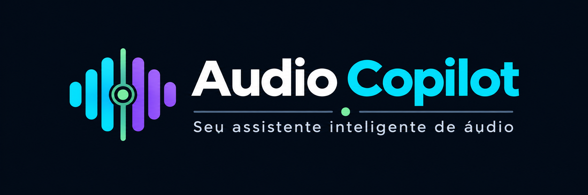

# Sprint D02 - Logo do Audio Copilot

## Objetivo

Definir a identidade visual oficial do Audio Copilot, estabelecendo o conceito da marca, seu significado e as diretrizes para utilização em toda a plataforma.

---

# Logo Oficial

## Versão 1

> Arquivo localizado em:
>
> `docs/ux/prototypes/logo-audio-copilot-v1.png`

---

# 1. Nome da Marca

**Audio Copilot**

---

# 2. Conceito

O Audio Copilot é um assistente inteligente para operadores de áudio.

Sua identidade visual representa a parceria entre o operador e a Inteligência Artificial, onde a IA atua como um copiloto, oferecendo suporte, recomendações e monitoramento contínuo, enquanto o operador mantém o controle das decisões.

O conceito central da marca é:

> **Seu assistente inteligente de áudio.**

---

# 3. Significado do Símbolo

O símbolo do Audio Copilot foi desenvolvido para transmitir os principais conceitos do produto.

Ele combina elementos que remetem a:

- medidores de nível (VU Meter);
- barras de equalização;
- ondas sonoras;
- processamento digital de áudio;
- operação em tempo real;
- equilíbrio entre operador e Inteligência Artificial.

Sua composição simétrica simboliza a colaboração entre a experiência humana e a assistência inteligente oferecida pelo sistema.

---

# 4. Valores da Marca

A identidade visual foi criada para transmitir:

- Inteligência;
- Confiabilidade;
- Simplicidade;
- Organização;
- Tecnologia;
- Precisão;
- Estabilidade;
- Profissionalismo.

---

# 5. Personalidade da Marca

O Audio Copilot deve ser percebido como:

- moderno;
- técnico;
- elegante;
- discreto;
- confiável;
- inteligente.

---

# 6. Estilo Visual

O logotipo segue um estilo:

- minimalista;
- flat design;
- moderno;
- limpo;
- escalável;
- facilmente reconhecível;
- legível em tamanhos reduzidos.

O símbolo foi projetado para funcionar tanto de forma independente quanto acompanhado do nome da marca.

---

# 7. Aplicações

A identidade visual poderá ser utilizada em:

- interface principal do sistema;
- aplicativo desktop;
- aplicativo mobile;
- favicon;
- splash screen;
- documentação;
- apresentações;
- website;
- GitHub;
- materiais institucionais.

---

# 8. Variações da Marca

A identidade deverá possuir versões para:

- fundo escuro;
- fundo claro;
- versão horizontal;
- símbolo isolado;
- monocromática;
- positiva;
- negativa.

---

# 9. Formatos dos Arquivos

A marca deverá ser disponibilizada nos formatos:

- SVG;
- PNG;
- PDF.

---

# 10. Diretrizes de Utilização

A identidade visual deverá manter consistência em todas as aplicações do projeto, preservando suas proporções, tipografia, cores e espaçamentos.

Alterações de cores, distorções ou modificações do símbolo deverão ser evitadas, garantindo o reconhecimento e a padronização da marca.

---

# Conclusão da Sprint

A Sprint D02 definiu a identidade visual oficial do Audio Copilot.

A marca representa a integração entre tecnologia, operação de áudio e Inteligência Artificial, reforçando o posicionamento do produto como um assistente inteligente para operadores de áudio.

---

# Situação da Sprint

**Status:** ✅ Concluída