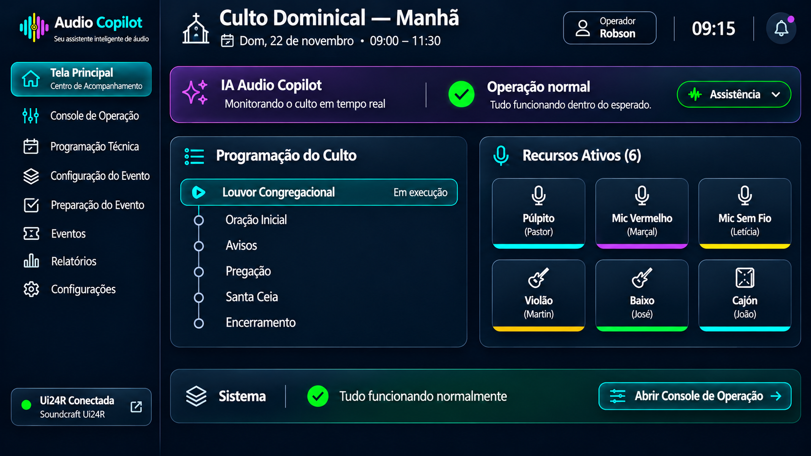

# Sprint D04 – Protótipo da Tela Principal

## Objetivo

Definir a interface principal do Audio Copilot, responsável por apresentar uma visão geral do evento em andamento.

A Tela Principal não tem como objetivo substituir o Console de Operação. Sua função é fornecer ao operador um painel simples, objetivo e de baixa carga cognitiva, permitindo acompanhar rapidamente o andamento do evento e navegar para as demais áreas do sistema quando necessário.

Ela funciona como um Centro de Comando, reunindo as informações essenciais do evento e servindo como ponto de partida para todas as demais telas.

---

# Protótipo

## Versão 4

---

# Filosofia da Tela

Durante a operação do culto, o operador precisa dedicar sua atenção principalmente ao que está acontecendo no templo, e não à interface do sistema.

Por esse motivo, a Tela Principal foi projetada para apresentar apenas as informações realmente importantes.

A filosofia adotada é:

- visão geral do evento;
- navegação rápida;
- baixa carga cognitiva;
- informações resumidas;
- acesso rápido ao Console de Operação;
- exibição de alertas apenas quando necessário.

Toda a operação detalhada da mesa ocorre no Console de Operação.

---

# Conceito

A Tela Principal funciona como um painel executivo.

Seu objetivo é responder rapidamente às principais perguntas do operador:

- Qual evento está acontecendo?
- Em que momento da programação estamos?
- Está tudo funcionando normalmente?
- Existe alguma ação que exige minha atenção?
- Para qual recurso devo navegar?

Se todas essas respostas forem positivas, o operador pode continuar acompanhando normalmente o culto.

---

# Estrutura da Tela

A interface é composta pelos seguintes blocos.

---

## Cabeçalho do Evento

Apresenta as principais informações do evento.

São exibidos:

- nome do evento;
- data;
- horário;
- operador responsável;
- relógio do sistema.

Exemplo:

- Culto Domingo Manhã;
- Domingo, 22 de novembro;
- 09:00 às 11:30;
- Operador: Robson.

---

## Painel da IA

Este é o principal componente da tela.

O painel informa o estado geral da operação.

São exibidos:

- modo de operação da IA;
- status geral;
- botão para assumir controle manual.

Exemplo:

- IA em modo Assistência;
- Tudo normal;
- Monitorando o áudio em tempo real.

Enquanto tudo estiver funcionando corretamente, nenhuma outra informação será exibida.

Caso algum problema seja detectado, este painel será atualizado automaticamente com alertas e recomendações.

---

## Momento Atual da Programação

Apresenta a etapa atualmente em execução dentro da Programação Técnica.

Exemplo:

- Louvor Congregacional (em execução).

Também exibe as próximas etapas previstas.

Exemplo:

- Oração Inicial;
- Avisos;
- Pregação;
- Santa Ceia;
- Encerramento.

Essa informação é sincronizada automaticamente com a Programação Técnica definida para o evento.

---

## Recursos Ativos

Apresenta apenas os recursos que estão sendo utilizados naquele evento.

Exemplos:

- Púlpito;
- Mic Vermelho;
- Mic Sem Fio;
- Violão Martin;
- Baixo;
- Cajón.

Recursos que foram desativados durante a Configuração do Evento não aparecem nesta tela.

---

## Navegação Inteligente

Todos os recursos ativos funcionam como atalhos inteligentes.

Ao clicar em um recurso, o sistema abre automaticamente o Console de Operação já posicionado no canal correspondente.

Exemplos:

Clique em:

- Violão Martin

↓

abre:

- Canal 10 — Violão Martin

Clique em:

- Baixo

↓

abre:

- Canal 02 — Baixo

Clique em:

- Púlpito

↓

abre:

- Canal 08 — Microfone do Púlpito

Ao abrir o Console, o canal selecionado recebe destaque visual temporário para facilitar sua localização.

---

## Saúde do Sistema

Apresenta apenas um resumo da infraestrutura necessária para o funcionamento do evento.

São monitorados:

- Ui24R;
- Rede;
- PA;
- Retornos;
- Stream;
- Gravação.

Quando todos estiverem funcionando corretamente, apenas um indicador resumido será apresentado.

Caso algum componente apresente falha, a tela destacará automaticamente o problema.

---

## Recomendações da IA

Esta área permanece oculta quando não houver nenhuma ação necessária.

Quando a IA identificar alguma situação relevante, uma recomendação será exibida automaticamente.

Exemplos:

- Reduzir retorno em 2 dB;
- Ajustar ganho do Canal 05;
- Possível início de microfonia;
- Nível elevado no PA.

Cada recomendação poderá levar diretamente ao Console de Operação já focado no recurso relacionado.

---

# Navegação

A Tela Principal é o ponto central de navegação do sistema.

A partir dela o operador poderá acessar:

- Programação Técnica;
- Configuração do Evento;
- Preparação do Evento;
- Console de Operação;
- Relatórios;
- Configurações.

Também será possível navegar diretamente para recursos específicos através dos atalhos inteligentes.

---

# Fluxo de Utilização

O fluxo esperado é:

1. Abrir o Audio Copilot.
2. Confirmar o evento carregado.
3. Verificar o estado geral da IA.
4. Confirmar a etapa atual da programação.
5. Acompanhar os recursos ativos.
6. Caso necessário, clicar diretamente em um recurso para abrir o Console de Operação.
7. Retornar à Tela Principal sempre que desejar uma visão geral do evento.

---

# Regras de Negócio

O sistema deverá seguir as seguintes regras:

- Exibir apenas os recursos ativos definidos na Configuração do Evento.
- Refletir automaticamente a Programação Técnica do evento.
- Ocultar recomendações quando não houver nenhuma ação necessária.
- Exibir alertas somente quando realmente relevantes.
- Permitir navegação contextual para o Console de Operação.
- Destacar automaticamente o recurso selecionado ao abrir o Console.
- Atualizar todas as informações em tempo real.

---

# Integração com Outras Telas

Recebe informações de:

- Programação Técnica;
- Configuração do Evento;
- Preparação do Evento.

Permite navegação para:

- Console de Operação;
- Relatórios;
- Configurações.

Também atua como ponto central de acompanhamento durante toda a execução do evento.

---

# Objetivos de UX

A interface deverá priorizar:

- simplicidade;
- baixa carga cognitiva;
- leitura rápida;
- poucos elementos visuais;
- navegação intuitiva;
- acesso contextual ao Console;
- foco na operação do culto;
- atualização em tempo real.

---

# Melhorias Futuras

Funcionalidades previstas para versões futuras:

- atualização automática da etapa da liturgia por horário ou ação do operador;
- destaque visual do recurso selecionado ao abrir o Console;
- filtros rápidos para recursos ativos;
- indicadores de qualidade de áudio resumidos;
- integração com o Painel da IA;
- notificações inteligentes não intrusivas;
- suporte a múltiplos operadores;
- personalização do Dashboard conforme o perfil do usuário.

---

# Situação da Sprint

**Status:** ✅ Concluída