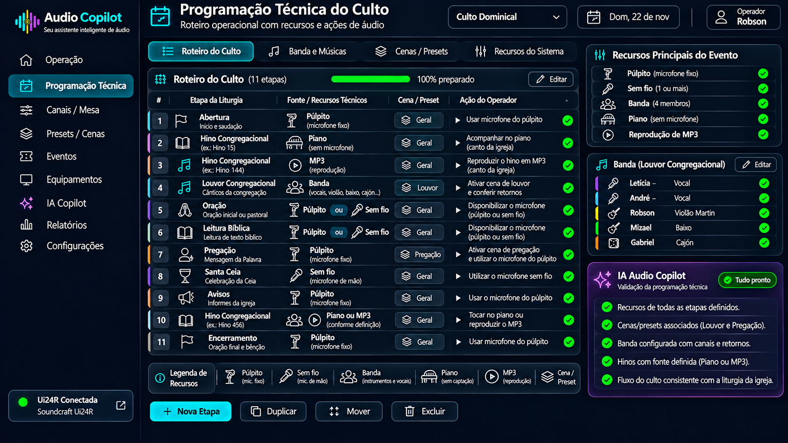

# Sprint D05 - Protótipo da Programação Técnica

## Objetivo

Definir a interface responsável pelo planejamento técnico do evento, permitindo que o operador prepare antecipadamente todos os recursos necessários para cada etapa da liturgia.

O foco desta tela não é organizar pessoas ou definir a condução do culto, mas garantir que todos os recursos de áudio estejam preparados para uma operação segura e eficiente.

---

# Evolução do Conceito

Durante a modelagem desta sprint foi identificado que a programação litúrgica e a programação técnica possuem objetivos diferentes.

## Programação Litúrgica

É de responsabilidade da igreja.

Pode sofrer alterações antes ou durante o culto.

Exemplos:

- quem fará a oração;
- quem fará a leitura bíblica;
- quem dará os avisos;
- quem conduzirá determinado momento.

Essas informações normalmente não são conhecidas antecipadamente e não fazem parte da responsabilidade do operador de áudio.

---

## Programação Técnica

É de responsabilidade do operador de áudio.

Seu objetivo é garantir que todos os recursos necessários para cada etapa do culto estejam preparados.

Esta é a função do Audio Copilot.

---

# Protótipo

## Versão 1

---

# Conceito da Tela

A Programação Técnica descreve as etapas do culto sob a perspectiva da operação de áudio.

Cada etapa informa apenas os recursos necessários para sua execução, independentemente de quem irá utilizá-los.

O operador prepara os recursos técnicos, enquanto a definição dos participantes permanece sob responsabilidade da igreja.

---

# Estrutura da Tela

A interface é composta pelas seguintes áreas.

## Barra Superior

Apresenta informações gerais do evento.

- Nome do evento;
- Data;
- Operador responsável;
- Status do planejamento;
- Barra de progresso da preparação.

---

## Programação Técnica

Lista todas as etapas do culto em ordem cronológica.

Exemplos:

- Abertura;
- Louvor Congregacional;
- Hino Congregacional;
- Oração;
- Leitura Bíblica;
- Pregação;
- Santa Ceia;
- Avisos;
- Encerramento.

---

## Recursos Técnicos

Cada etapa informa apenas os recursos necessários para sua realização.

Exemplos:

- Microfone do púlpito;
- Microfone sem fio;
- Banda;
- Piano;
- Reprodução de MP3;
- Cena da mesa;
- Preset;
- Retornos.

---

## Situação dos Recursos

Cada recurso possui um indicador de status.

Exemplos:

- configurado;
- pendente;
- indisponível;
- necessita revisão.

---

## Painel da Inteligência Artificial

A IA atua como assistente técnico durante o planejamento.

Ela identifica automaticamente possíveis inconsistências antes do ensaio ou culto.

Exemplos:

- microfone não configurado;
- preset inexistente;
- cena não cadastrada;
- arquivo MP3 ausente;
- retorno não atribuído;
- bateria baixa do microfone sem fio.

---

# Recursos Identificados

Durante esta sprint foram definidos os principais recursos técnicos utilizados na operação.

## Recursos de Captação

- Microfone do púlpito;
- Microfone sem fio;
- Headset.

---

## Recursos Musicais

- Banda;
- Piano;
- Reprodução de MP3;
- Playback.

---

## Recursos da Mesa

- Cena;
- Preset;
- Retornos.

---

# Fluxo Operacional

A programação técnica não determina quem participará de cada etapa.

Ela informa apenas quais recursos deverão estar disponíveis.

Exemplo:

| Etapa | Recursos Técnicos |
|--------|-------------------|
| Abertura | Microfone do púlpito |
| Louvor Congregacional | Banda + Cena Louvor + Retornos |
| Hino Congregacional | Piano ou MP3 |
| Oração | Microfone do púlpito ou Microfone sem fio |
| Leitura Bíblica | Microfone do púlpito ou Microfone sem fio |
| Pregação | Microfone do púlpito + Cena Pregação |
| Santa Ceia | Microfone sem fio |
| Avisos | Microfone do púlpito |
| Encerramento | Microfone do púlpito |

---

# Filosofia da Programação Técnica

O Audio Copilot foi projetado para auxiliar o operador de áudio, e não para controlar a liturgia.

Por esse motivo, a Programação Técnica concentra-se exclusivamente nos recursos necessários para cada etapa do culto.

Caso a igreja altere participantes ou a ordem da liturgia durante o evento, o operador continuará preparado, pois os recursos técnicos permanecerão disponíveis.

---

# Objetivos de UX

A interface deverá priorizar:

- rapidez na preparação do evento;
- organização dos recursos técnicos;
- baixa carga cognitiva;
- leitura imediata das informações;
- integração com a Inteligência Artificial;
- mínima quantidade de cliques;
- operação eficiente antes do culto.

---

# Conclusão da Sprint

A Sprint D05 definiu um dos principais diferenciais do Audio Copilot: a separação entre a Programação Litúrgica e a Programação Técnica.

Enquanto a liturgia permanece sob responsabilidade da igreja e pode sofrer alterações a qualquer momento, a Programação Técnica garante que todos os recursos de áudio necessários estejam preparados para uma operação segura e organizada.

Esse conceito torna o sistema mais flexível, reduz erros operacionais e aproxima o Audio Copilot da realidade das equipes de sonorização de igrejas.

---

# Situação da Sprint

**Status:** ✅ Concluída