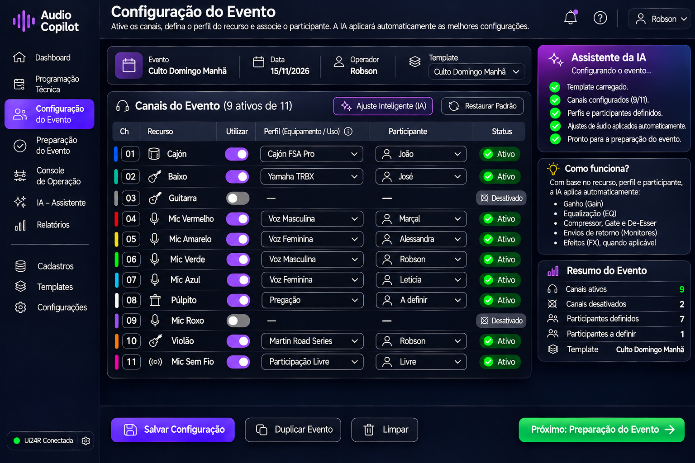

# Sprint D06 – Protótipo da Configuração do Evento

## Objetivo

Definir a interface responsável por configurar tecnicamente cada evento, informando ao Audio Copilot quais recursos da mesa de som serão utilizados e quem será responsável por cada um deles.

Esta é a primeira etapa operacional do sistema e serve como base para todas as etapas seguintes.

A partir das informações fornecidas pelo operador, o Audio Copilot configura automaticamente a mesa Soundcraft Ui24R, aplicando os presets mais adequados para cada participante e equipamento.

---

# Protótipo

## Versão 2

---

# Descrição Geral

A Configuração do Evento representa o momento em que o operador informa ao sistema como será o culto ou ensaio.

Nesta etapa, não são realizados ajustes manuais na mesa de som.

O operador apenas informa:

- quais recursos serão utilizados;
- qual o perfil (equipamento ou tipo de utilização) de cada recurso;
- quem utilizará cada recurso.

A partir dessas informações, o Audio Copilot identifica automaticamente os melhores presets e configura toda a cadeia de processamento da Ui24R.

---

# Filosofia da Tela

O Audio Copilot separa completamente a infraestrutura física da configuração do evento.

Os canais da mesa permanecem fixos conforme a instalação da igreja.

Exemplo:

- Canal 01 → Cajón
- Canal 02 → Baixo
- Canal 03 → Guitarra
- Canal 04 → Microfone Vermelho
- Canal 05 → Microfone Amarelo
- Canal 06 → Microfone Verde
- Canal 07 → Microfone Azul
- Canal 08 → Microfone do Púlpito
- Canal 09 → Microfone Roxo
- Canal 10 → Violão
- Canal 11 → Microfone Sem Fio

O operador nunca altera essa estrutura.

Ele apenas informa como esses recursos serão utilizados naquele evento.

---

# Estrutura da Tela

A interface é composta pelas seguintes áreas.

---

## Cabeçalho do Evento

Exibe as informações gerais do evento.

São apresentados:

- Nome do evento;
- Data;
- Operador responsável;
- Template selecionado;
- Botão para carregar templates.

Exemplos de templates:

- Culto Domingo Manhã;
- Culto Domingo Noite;
- Estudo Bíblico;
- Reunião de Oração;
- Ensaio da Banda.

---

## Lista de Recursos

Esta é a principal área da tela.

Cada linha representa um recurso físico previamente instalado na igreja.

São exibidas as seguintes informações:

- Canal;
- Recurso (fixo);
- Utilizar no evento;
- Perfil;
- Participante;
- Status.

---

## Utilizar no Evento

Define se determinado recurso participará daquele evento.

Caso o recurso não seja utilizado, ele permanecerá desativado durante toda a preparação e operação.

Recursos desativados não serão exibidos nas próximas etapas do sistema.

---

## Perfil

O Perfil descreve como aquele recurso será utilizado.

Ele varia conforme o tipo de equipamento.

Exemplos:

### Violão

- Martin Road Series
- Violão da Igreja
- Violão Nylon

### Baixo

- Baixo da Igreja
- Fender Jazz Bass
- Yamaha TRBX

### Microfones

- Voz Masculina
- Voz Feminina
- Pregação
- Participação Livre

O Perfil é utilizado pela Inteligência Artificial para identificar o processamento de áudio mais adequado.

---

## Participante

Identifica quem utilizará determinado recurso durante o evento.

Exemplos:

- Marçal
- Alessandra
- Robson
- Letícia

Alguns recursos poderão permanecer sem participante definido.

Exemplo:

Microfone do Púlpito.

Durante o ensaio normalmente ainda não se sabe quem será o pregador.

Nesse caso, o recurso permanece ativo e o participante poderá ser informado posteriormente.

O Microfone Sem Fio normalmente permanece configurado como:

- Livre

pois será utilizado em orações ou participações espontâneas.

---

# Configuração Inteligente

Esta é a principal funcionalidade da tela.

Sempre que o operador selecionar um Perfil e um Participante, o Audio Copilot localizará automaticamente o preset mais adequado.

Exemplo:

Canal 10

Recurso:
Violão

Perfil:
Martin Road Series

Participante:
Robson

O sistema identificará automaticamente o melhor conjunto de configurações para essa combinação.

Entre os parâmetros configurados automaticamente estão:

- ganho inicial;
- filtro passa-altas (HPF);
- equalização;
- compressor;
- gate;
- de-esser;
- efeitos;
- envios para retorno;
- panorama;
- demais parâmetros específicos do canal.

Todo esse processo ocorre de forma transparente ao operador.

---

# Assistente da IA

Durante toda a configuração, a Inteligência Artificial acompanha as escolhas do operador.

Ela realiza automaticamente:

- validação da configuração;
- verificação de inconsistências;
- identificação de recursos sem participante;
- conferência dos canais ativos;
- preparação automática da Ui24R.

A IA também poderá sugerir melhorias sempre que identificar alguma situação incomum.

---

## Resumo do Evento

Apresenta uma visão geral da configuração.

São exibidos:

- quantidade de canais ativos;
- canais desativados;
- participantes definidos;
- participantes pendentes;
- template utilizado.

Esse painel permite validar rapidamente se o evento está corretamente configurado.

---

## Barra Inferior

Disponibiliza as principais ações da tela.

- Salvar Configuração;
- Duplicar Evento;
- Limpar Configuração;
- Avançar para a Preparação do Evento.

---

# Fluxo de Utilização

O fluxo esperado é:

1. Selecionar o template do evento.
2. Ativar os recursos que serão utilizados.
3. Definir o Perfil de cada recurso.
4. Informar o Participante.
5. Permitir que a IA configure automaticamente a mesa.
6. Salvar a configuração.
7. Prosseguir para a Preparação do Evento.

---

# Regras de Negócio

O sistema deverá seguir as seguintes regras.

- Os canais físicos são permanentes.
- O recurso associado a cada canal não poderá ser alterado.
- Apenas a utilização do recurso poderá ser ativada ou desativada.
- O Perfil poderá variar conforme o equipamento ou finalidade.
- O Participante poderá ser alterado a qualquer momento.
- O participante do púlpito poderá permanecer indefinido.
- O Microfone Sem Fio poderá permanecer como "Livre".
- Recursos desativados não participarão da preparação nem da operação.
- Sempre que Perfil e Participante forem definidos, a IA deverá configurar automaticamente o canal correspondente.
- O operador não precisa selecionar presets manualmente.

---

# Integração com Outras Telas

Esta tela fornece informações para:

- Programação Técnica;
- Preparação do Evento;
- Console de Operação;
- Painel da IA;
- Relatórios do Evento.

Toda a operação do Audio Copilot será baseada na configuração realizada nesta etapa.

---

# Objetivos de UX

A interface deverá priorizar:

- simplicidade;
- rapidez na configuração;
- baixo número de cliques;
- reutilização de templates;
- preenchimento intuitivo;
- automação das configurações técnicas;
- redução da necessidade de conhecimento avançado da mesa de som.

---

# Melhorias Futuras

Funcionalidades previstas para versões futuras:

- preenchimento automático de participantes;
- sugestões inteligentes de perfis;
- aprendizado contínuo baseado em eventos anteriores;
- criação automática de novos presets;
- integração com escalas do ministério de louvor;
- detecção automática de equipamentos conectados;
- sincronização em tempo real com a Ui24R.

---

# Situação da Sprint

**Status:** ✅ Concluída