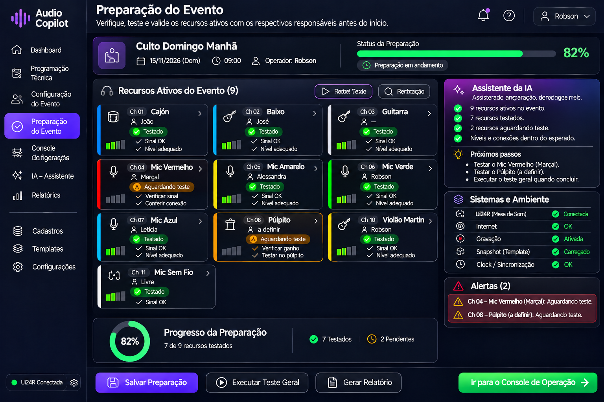

# Sprint D07 – Protótipo da Preparação do Evento

## Objetivo

Definir a interface responsável por validar toda a configuração realizada automaticamente pelo Audio Copilot antes do início da operação do evento.

Nesta etapa, a mesa de som já foi configurada pela Inteligência Artificial com base nas informações definidas na Configuração do Evento.

O objetivo da Preparação do Evento é confirmar que todos os participantes, equipamentos e canais configurados estão funcionando corretamente, realizando apenas pequenos refinamentos quando necessário.

---

# Protótipo

## Versão 1

---

# Descrição Geral

A Preparação do Evento representa a última etapa antes do início da operação ao vivo.

Nesta fase, o operador não configura mais a mesa de som.

Toda a configuração inicial da Soundcraft Ui24R já foi realizada automaticamente pelo Audio Copilot durante a etapa de Configuração do Evento.

Agora, o objetivo é apenas validar se todos os participantes e equipamentos estão funcionando conforme esperado.

O sistema apresenta apenas os recursos ativos definidos anteriormente.

Recursos desativados não são exibidos, tornando a interface mais limpa e permitindo que o operador concentre sua atenção apenas no que realmente será utilizado durante o evento.

---

# Filosofia da Tela

A Preparação do Evento funciona como uma etapa de validação da configuração automática realizada pela Inteligência Artificial.

Cada recurso já possui:

- canal definido;
- perfil selecionado;
- participante associado;
- preset aplicado automaticamente.

O operador apenas acompanha os testes realizados pelos participantes, enquanto o Audio Copilot monitora continuamente os sinais da mesa e verifica se todos os recursos estão prontos para utilização.

Dessa forma, o operador sabe exatamente quem ainda precisa realizar os testes e quais recursos ainda aguardam validação.

---

# Configuração Automática

Antes da abertura desta tela, o Audio Copilot já realizou automaticamente toda a configuração da Ui24R com base nas informações definidas na Configuração do Evento.

Entre as configurações aplicadas automaticamente estão:

- ganho inicial;
- filtro passa-altas (HPF);
- equalização;
- compressor;
- gate;
- de-esser;
- efeitos;
- envios para retorno;
- panorama;
- demais parâmetros específicos de cada canal.

Durante a Preparação do Evento essas configurações são apenas validadas.

Caso a Inteligência Artificial identifique necessidade de pequenos ajustes durante os testes, ela poderá sugeri-los ao operador ou aplicá-los automaticamente, conforme a configuração do sistema.

---

# Estrutura da Tela

A interface é composta pelas seguintes áreas.

---

## Cabeçalho do Evento

Apresenta as informações gerais do evento.

São exibidos:

- Nome do evento;
- Data;
- Horário;
- Operador responsável;
- Status da preparação;
- Barra de progresso.

Exemplo:

- Culto Domingo Manhã;
- Operador: Robson;
- Preparação em andamento;
- 82% concluída.

---

## Recursos Ativos do Evento

Esta é a principal área da tela.

Cada recurso ativo é apresentado em um cartão contendo:

- Canal;
- Recurso;
- Perfil;
- Participante;
- Status do teste;
- Indicadores de sinal;
- Validações realizadas.

Exemplo:

### Violão Martin

Participante:

Robson

Status:

- Configuração aplicada;
- Sinal OK;
- Teste realizado;
- Nível adequado.

---

### Mic Vermelho

Participante:

Marçal

Status:

- Configuração aplicada;
- Aguardando teste;
- Verificar sinal.

---

### Púlpito

Participante:

A definir

Status:

- Configuração aplicada;
- Aguardando teste;
- Testar durante o culto ou antes da mensagem.

---

## Participantes

Cada recurso apresenta automaticamente o participante definido durante a Configuração do Evento.

Alguns recursos poderão permanecer sem participante definido.

Exemplo:

Microfone do Púlpito.

Durante o ensaio normalmente ainda não se sabe quem será o pregador.

Nesse caso, o recurso permanece ativo e poderá receber o participante durante o próprio culto.

O Microfone Sem Fio normalmente permanece configurado como:

- Livre

pois será utilizado em orações, avisos ou participações espontâneas.

---

## Assistente da IA

Durante toda a preparação, a Inteligência Artificial monitora continuamente o sistema.

São apresentadas informações como:

- recursos ativos;
- recursos testados;
- recursos pendentes;
- progresso da preparação;
- validações automáticas;
- sugestões de refinamento.

Exemplo:

- 9 recursos ativos;
- 7 recursos testados;
- 2 recursos aguardando teste.

A IA também informa quais participantes ainda precisam validar seus recursos.

Caso detecte alguma inconsistência durante os testes, poderá sugerir pequenos ajustes antes do início da operação.

---

## Sistemas e Ambiente

Esta área monitora toda a infraestrutura necessária para o evento.

Exemplos:

- Ui24R conectada;
- Internet disponível;
- Gravação ativada;
- Snapshot carregado;
- Sincronização concluída.

Essas verificações garantem que todo o sistema esteja pronto para iniciar a operação.

---

## Alertas

Exibe situações que exigem atenção do operador.

Exemplos:

- Mic Vermelho (Marçal): aguardando teste.
- Púlpito: participante ainda não definido.
- Violão Martin (Robson): pequeno ajuste de ganho recomendado.

No futuro, esta área também poderá apresentar:

- clipping;
- ausência de sinal;
- ruído excessivo;
- ganho inadequado;
- risco de microfonia;
- sobrecarga de retorno;
- possíveis falhas de conexão.

---

## Progresso da Preparação

Apresenta o percentual geral da preparação.

O progresso é atualizado automaticamente conforme os participantes realizam seus testes.

Exemplo:

- 82% concluída;
- 7 recursos validados;
- 2 recursos aguardando teste.

Quando todos os recursos forem validados, o sistema indicará que o evento está pronto para iniciar.

---

## Barra Inferior

Disponibiliza as principais ações da tela.

- Salvar Preparação;
- Executar Teste Geral;
- Gerar Relatório;
- Iniciar Operação.

---

# Fluxo de Utilização

O fluxo esperado é:

1. Abrir a Preparação do Evento.
2. Conferir a configuração automática realizada pela IA.
3. Solicitar que cada participante teste seu instrumento ou microfone.
4. Validar os indicadores apresentados pelo sistema.
5. Permitir que a IA realize pequenos refinamentos quando necessário.
6. Resolver eventuais alertas.
7. Confirmar que todos os recursos foram validados.
8. Iniciar a operação ao vivo.

---

# Regras de Negócio

O sistema deverá seguir as seguintes regras:

- Exibir apenas os recursos ativos definidos na Configuração do Evento.
- Utilizar automaticamente as configurações aplicadas pela IA na etapa anterior.
- Associar cada recurso ao seu respectivo participante.
- Permitir recursos sem participante quando necessário.
- Atualizar automaticamente o progresso da preparação.
- Registrar todas as validações realizadas.
- Informar ao operador quais recursos ainda aguardam teste.
- Permitir pequenos refinamentos automáticos durante os testes.
- Liberar a operação somente após a conclusão da preparação.

---

# Integração com Outras Telas

Esta tela recebe informações da:

- Configuração do Evento.

E fornece informações para:

- Console de Operação;
- Painel da IA;
- Relatórios do Evento.

Todo o histórico da preparação ficará disponível para consultas futuras e servirá como base para o aprendizado contínuo da Inteligência Artificial.

---

# Objetivos de UX

A interface deverá priorizar:

- validação rápida da configuração automática;
- acompanhamento visual do progresso;
- identificação imediata dos recursos pendentes;
- associação clara entre recurso, perfil e participante;
- baixa carga cognitiva;
- monitoramento em tempo real;
- mínima necessidade de intervenção manual;
- interface limpa e organizada.

---

# Melhorias Futuras

Funcionalidades previstas para versões futuras:

- detecção automática de áudio em cada canal;
- validação automática dos níveis de sinal;
- identificação de clipping durante os testes;
- detecção preventiva de risco de microfonia;
- confirmação automática dos testes concluídos;
- refinamento contínuo dos presets com base no histórico de utilização;
- integração com sistemas profissionais que disponibilizem telemetria;
- geração automática de checklist de preparação;
- aprendizado contínuo da IA a partir dos ajustes realizados em cada evento.

---

# Situação da Sprint

**Status:** ✅ Concluída