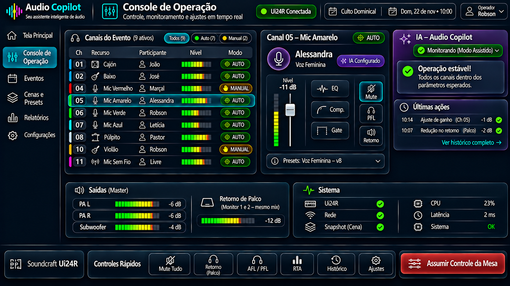

# Sprint D08 – Protótipo do Console de Operação

## Objetivo

Definir a interface utilizada durante a operação ao vivo do culto ou ensaio.

Nesta etapa, todos os recursos já foram configurados e validados nas sprints anteriores. O Console de Operação concentra o monitoramento em tempo real da mesa Soundcraft Ui24R, permitindo que o operador acompanhe os níveis de áudio, intervenha quando necessário e trabalhe em conjunto com o Audio Copilot.

---

# Protótipo

## Versão 2

---

# Descrição Geral

O Console de Operação representa o centro de controle do Audio Copilot durante a execução do evento.

Nesta tela, o operador acompanha continuamente o comportamento dos canais ativos, das saídas da mesa e das sugestões da Inteligência Artificial.

Diferentemente da Configuração do Evento, nenhuma associação entre participantes, equipamentos ou perfis é realizada nesta etapa. Todo esse trabalho já foi concluído anteriormente.

O Console é dedicado exclusivamente à operação em tempo real.

---

# Filosofia da Tela

O Audio Copilot atua como um **copiloto**.

A Inteligência Artificial monitora continuamente toda a operação, identifica situações que merecem atenção e, quando permitido, realiza pequenos ajustes automáticos.

O operador permanece como autoridade máxima sobre a mesa de som.

A qualquer momento ele pode assumir completamente o controle de qualquer canal ou de toda a operação.

---

## Filosofia de Operação

Durante a execução do evento, o operador deve manter o foco na operação do áudio e não na interpretação da interface.

Por esse motivo, o Audio Copilot adota uma abordagem de baixa carga cognitiva.

Informações críticas permanecem sempre visíveis.

Informações secundárias aparecem apenas quando necessárias, permitindo que o operador concentre sua atenção no que realmente importa durante o culto.

---

# Estrutura da Tela

A interface é composta pelas seguintes áreas.

---

## Barra Superior

Apresenta as informações gerais do evento.

São exibidos:

- Evento em andamento;
- Data e horário;
- Operador responsável;
- Status da conexão com a Ui24R.

---

## Navegação

A barra lateral permite acesso rápido às principais áreas do sistema.

- Tela Principal
- Console de Operação
- Eventos
- Cenas e Presets
- Relatórios
- Configurações

Mesmo durante a operação, o operador pode retornar rapidamente ao Dashboard para acompanhar a visão geral do evento.

---

## Lista de Canais

A principal área da tela apresenta todos os recursos ativos definidos na Configuração do Evento.

Cada linha apresenta:

- Número do canal;
- Recurso utilizado;
- Participante associado;
- Medidor de nível em tempo real;
- Modo de operação (Auto ou Manual).

Exemplo:

| Canal | Recurso | Participante | Modo |
|-------:|----------|--------------|------|
| 04 | Mic Vermelho | Marçal | Manual |
| 05 | Mic Amarelo | Alessandra | Auto |
| 06 | Mic Verde | Robson | Auto |
| 08 | Púlpito | Pastor João | Auto |

Os canais desativados não são exibidos.

---

## Canal Selecionado

Ao selecionar um canal, são exibidas suas informações detalhadas.

São apresentados:

- Participante;
- Perfil configurado;
- Medidor de nível;
- Controle de volume (Fader);
- Botão Mute;
- AFL/PFL;
- Controle do retorno de palco;
- Preset aplicado.

O operador poderá realizar ajustes rápidos durante a operação sem precisar acessar outras telas.

---

## Modos de Operação

Cada canal pode operar em dois modos.

### AUTO

A Inteligência Artificial poderá realizar pequenos ajustes automáticos previamente autorizados.

Exemplos:

- pequenos ajustes de ganho;
- correções de retorno;
- ajustes preventivos.

### MANUAL

Quando o operador alterar manualmente um canal, ele passa automaticamente para o modo **Manual**.

Nesse estado:

- a IA continua monitorando o canal;
- sugestões continuam sendo apresentadas;
- nenhum ajuste automático será realizado naquele canal até que o operador retorne ao modo automático.

Essa abordagem evita conflitos entre o operador e a Inteligência Artificial.

---

## Assistente da IA

O painel da IA apresenta apenas as informações essenciais para a operação.

Seu principal objetivo é informar rapidamente a situação geral do sistema sem competir visualmente com o Console de Operação.

Normalmente são exibidos:

- status da operação;
- modo atual da IA;
- última ação executada.

Exemplo:

- Operação estável;
- IA monitorando em modo assistido;
- Ajuste de ganho realizado no Canal 05.

Quando houver alguma recomendação importante, o painel será expandido automaticamente para apresentar a sugestão ao operador.

Na ausência de recomendações, o painel permanece compacto, reduzindo a carga cognitiva durante a operação.

---

## Histórico da IA

Todas as ações executadas pelo Audio Copilot ficam registradas.

Exemplos:

- 10:07 — Redução de 2 dB no retorno de palco.
- 10:14 — Ajuste de ganho no Canal 05.

Esse histórico permite compreender as decisões tomadas pela IA durante o evento e poderá ser utilizado posteriormente na geração dos relatórios e no aprendizado contínuo do sistema.

---

## Saídas da Mesa

São monitoradas as principais saídas utilizadas pela igreja.

- PA Esquerdo;
- PA Direito;
- Subwoofer;
- Retorno de Palco.

Como os dois monitores de palco compartilham exatamente a mesma mixagem, o sistema apresenta apenas um único controle de **Retorno de Palco**.

---

## Saúde do Sistema

Apresenta os principais indicadores do ambiente operacional.

São monitorados:

- Conexão com a Ui24R;
- Rede;
- Snapshot carregado;
- Utilização de CPU;
- Latência;
- Funcionamento geral do sistema.

Esses indicadores auxiliam na identificação rápida de problemas de infraestrutura.

---

## Controles Rápidos

A barra inferior reúne os comandos mais utilizados durante a operação.

São disponibilizados:

- Mute Geral;
- Retorno de Palco;
- AFL/PFL;
- RTA;
- Histórico;
- Ajustes.

Todos os comandos permanecem acessíveis sem comprometer a visualização dos canais.

---

## Assumir Controle da Mesa

O botão **Assumir Controle da Mesa** permite que o operador desative temporariamente a atuação automática da Inteligência Artificial.

Quando acionado:

- todos os canais passam para o modo Manual;
- a IA continua monitorando o sistema;
- nenhuma alteração automática será realizada.

Essa funcionalidade garante que o operador mantenha sempre a decisão final sobre a operação.

---

# Fluxo de Utilização

O fluxo esperado é:

1. Iniciar o Console de Operação após concluir a Preparação do Evento.
2. Acompanhar continuamente os níveis dos canais ativos.
3. Monitorar as sugestões da IA.
4. Realizar ajustes manuais quando necessário.
5. Permitir que a IA execute pequenas correções autorizadas.
6. Assumir o controle completo da mesa sempre que desejar.
7. Retornar à Tela Principal para acompanhar a visão geral do evento, quando necessário.
8. Encerrar o evento mantendo o histórico das ações realizadas.

---

# Regras de Negócio

O sistema deverá seguir as seguintes regras:

- Exibir apenas os canais ativos definidos na Configuração do Evento.
- Exibir o participante associado a cada recurso.
- Diferenciar claramente os modos Auto e Manual.
- Impedir que a IA altere automaticamente canais colocados em modo Manual.
- Registrar todas as ações executadas pela IA.
- Permitir que o operador assuma completamente o controle da mesa a qualquer momento.
- Preservar o operador como autoridade máxima sobre a operação do áudio.

---

# Integração com Outras Telas

Esta tela recebe informações da:

- Configuração do Evento;
- Preparação do Evento.

E fornece informações para:

- Tela Principal (Dashboard);
- Painel da IA;
- Relatórios do Evento.

Todo o histórico da operação poderá ser consultado posteriormente.

---

# Objetivos de UX

A interface deverá priorizar:

- monitoramento em tempo real;
- baixa carga cognitiva;
- identificação imediata dos canais ativos;
- acesso rápido aos controles mais utilizados;
- rápida alternância entre operação manual e automática;
- interface limpa e organizada;
- foco total na operação ao vivo.

---

# Melhorias Futuras

Funcionalidades previstas para versões futuras:

- identificação automática do participante que está falando;
- aprendizado contínuo dos ajustes realizados pelo operador;
- recomendações baseadas no histórico de eventos anteriores;
- comparação entre configurações de diferentes cultos;
- operação parcialmente autônoma mediante autorização do operador;
- integração com os relatórios inteligentes do Audio Copilot.
- apresentação dinâmica de painéis, exibindo recomendações da IA apenas quando realmente necessárias.   

---

# Situação da Sprint

**Status:** ✅ Concluída