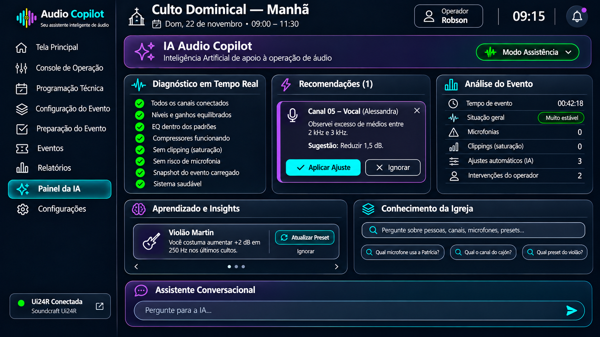

# Sprint D09 – Protótipo do Painel da IA

## Objetivo

Definir a interface responsável por apresentar toda a inteligência do Audio Copilot.

Diferentemente das demais telas, o Painel da IA não é destinado ao controle direto da mesa de som.

Seu objetivo é analisar continuamente a operação, aprender com os operadores, sugerir melhorias e explicar todas as decisões tomadas pelo sistema.

O Painel da IA representa o "cérebro" do Audio Copilot.

---

# Protótipo

## Versão 1

---

# Filosofia da Tela

O Audio Copilot não foi criado para substituir o operador de áudio.

Seu propósito é atuar como um operador experiente ao lado do usuário, reduzindo a carga de trabalho durante o culto.

A IA observa continuamente o funcionamento da mesa, identifica oportunidades de melhoria e apresenta recomendações claras, sempre permitindo que o operador mantenha o controle das decisões.

O operador continua sendo o responsável pela operação.

A IA atua como um copiloto inteligente.

---

# Conceito

O Painel da IA reúne todas as informações relacionadas à inteligência do sistema.

Ele permite acompanhar:

- diagnóstico da operação;
- recomendações em tempo real;
- histórico de decisões;
- aprendizado contínuo;
- estatísticas do evento;
- explicações das ações da IA.

É uma tela voltada para análise e acompanhamento, não para mixagem.

---

# Níveis de Autonomia

O Audio Copilot poderá operar em três modos.

## Manual

A IA apenas monitora o sistema.

Nenhuma sugestão ou ajuste é realizado automaticamente.

---

## Assistido (Padrão)

A IA monitora continuamente a operação e apresenta sugestões ao operador.

Exemplo:

- reduzir ganho;
- ajustar EQ;
- aplicar um preset;
- alterar compressor;
- corrigir risco de microfonia.

Todas as alterações dependem da aprovação do operador.

Este será o modo recomendado para utilização do sistema.

---

## Automático (Futuro)

A IA poderá executar automaticamente pequenas correções previamente autorizadas.

Exemplos:

- redução de ganho;
- aplicação de EQ;
- controle preventivo de microfonia;
- pequenos ajustes de dinâmica.

Todas as ações ficarão registradas no histórico do evento.

---

# Estrutura da Tela

A interface é composta pelos seguintes módulos.

---

## Diagnóstico em Tempo Real

Apresenta o estado atual da operação.

São monitorados continuamente:

- clipping;
- feedback;
- níveis de sinal;
- ganho;
- equalização;
- compressor;
- gate;
- phantom power;
- snapshots;
- saúde geral da mesa.

Exemplo:

- Todos os canais conectados.
- Nenhum clipping detectado.
- Ganhos equilibrados.
- Snapshot carregado.
- Sistema estável.

---

## Recomendações

Esta área apresenta sugestões geradas pela IA.

Cada sugestão explica:

- o problema identificado;
- a justificativa técnica;
- a ação recomendada.

Exemplo:

Canal 05 — Alessandra

A IA detectou excesso de médios entre 2 kHz e 3 kHz.

Sugestão:

- reduzir 1,5 dB.

Ações disponíveis:

- Aplicar;
- Ignorar.

Todas as recomendações permanecem registradas no histórico.

---

## Análise do Evento

Apresenta um resumo operacional do evento em andamento.

Exemplos:

- tempo de operação;
- quantidade de ajustes automáticos;
- quantidade de recomendações;
- número de intervenções do operador;
- clipping detectados;
- microfonias evitadas;
- estabilidade geral da operação.

Esse painel permite acompanhar o comportamento do sistema durante todo o culto.

---

## Aprendizado Contínuo

Este é um dos principais diferenciais do Audio Copilot.

A IA observa os padrões de utilização ao longo dos cultos.

Exemplos:

- determinado vocalista sempre utiliza o mesmo microfone;
- um instrumento sempre recebe a mesma equalização;
- determinado operador realiza sempre os mesmos ajustes.

Quando identificar padrões consistentes, a IA poderá sugerir:

- atualização de presets;
- criação de novos perfis;
- alteração de configurações padrão.

Exemplo:

"Você sempre aumenta 2 dB em 250 Hz no Violão Martin.

Deseja atualizar o preset?"

---

## Memória Operacional

O Painel da IA também funciona como uma base de conhecimento da equipe de áudio.

A IA registra informações como:

- equipamentos utilizados;
- participantes;
- presets;
- canais;
- configurações históricas;
- eventos anteriores.

Exemplo:

Pergunta:

"Qual microfone utiliza a Patrícia?"

Resposta:

Mic Roxo — Canal 09.

Outro exemplo:

"Qual preset é utilizado no Violão Martin?"

Resposta:

Preset Violão Martin V4.

Essa funcionalidade evita que o conhecimento fique concentrado apenas em operadores experientes.

---

## Assistente Conversacional

Na parte inferior da tela existe um campo para interação direta com a IA.

O operador poderá realizar perguntas em linguagem natural.

Exemplos:

- Por que você reduziu o ganho?
- Qual canal está mais próximo do clipping?
- Quem utiliza o Mic Vermelho?
- Qual preset está ativo no Canal 10?
- Quantos ajustes você realizou hoje?

A IA deverá responder explicando claramente seus motivos.

Exemplo:

"Reduzi o ganho do Canal 08 porque a voz permaneceu acima de -3 dBFS durante 18 segundos, indicando risco de clipping."

---

# Fluxo de Utilização

O fluxo esperado é:

1. Abrir o Painel da IA.
2. Verificar o diagnóstico geral.
3. Avaliar as recomendações apresentadas.
4. Aprovar ou ignorar sugestões.
5. Consultar análises do evento.
6. Acompanhar o aprendizado da IA.
7. Realizar perguntas ao assistente quando necessário.

---

# Regras de Negócio

O sistema deverá seguir as seguintes regras:

- Nunca alterar configurações automaticamente no modo Assistido.
- Explicar todas as recomendações apresentadas.
- Registrar todas as decisões da IA.
- Registrar todas as decisões do operador.
- Aprender continuamente com os eventos realizados.
- Manter histórico completo de recomendações.
- Permitir consulta às informações históricas.
- Possibilitar futura operação em modo automático.

---

# Integração com Outras Telas

Recebe informações de:

- Configuração do Evento;
- Preparação do Evento;
- Console de Operação;
- Programação Técnica.

Fornece informações para:

- Relatórios;
- Dashboard Principal;
- Sistema de Presets;
- Histórico do Evento.

A IA acompanha todas as etapas do evento desde sua configuração até o encerramento.

---

# Objetivos de UX

A interface deverá priorizar:

- transparência das decisões;
- confiança no sistema;
- baixa carga cognitiva;
- explicações claras;
- recomendações objetivas;
- aprendizado contínuo;
- consulta rápida às informações;
- interação em linguagem natural.

---

# Visão de Longo Prazo

O objetivo do Painel da IA é transformar o Audio Copilot em um verdadeiro copiloto inteligente.

Ao longo dos meses de utilização, a IA deverá conhecer profundamente a operação da igreja, aprendendo:

- os operadores;
- os músicos;
- os vocalistas;
- os pregadores;
- os instrumentos;
- os equipamentos;
- os presets mais utilizados;
- o comportamento acústico do templo.

Esse conhecimento permitirá recomendações cada vez mais precisas, tornando a operação mais rápida, consistente e segura.

---

# Melhorias Futuras

Funcionalidades previstas para versões futuras:

- aprendizado automático de presets;
- identificação de padrões de operação;
- prevenção inteligente de microfonia;
- otimização automática de ganho;
- explicação detalhada de todas as decisões;
- sugestões baseadas em eventos anteriores;
- integração com modelos avançados de Inteligência Artificial;
- modo totalmente automático (opcional).

---

# Situação da Sprint

**Status:** ✅ Concluída