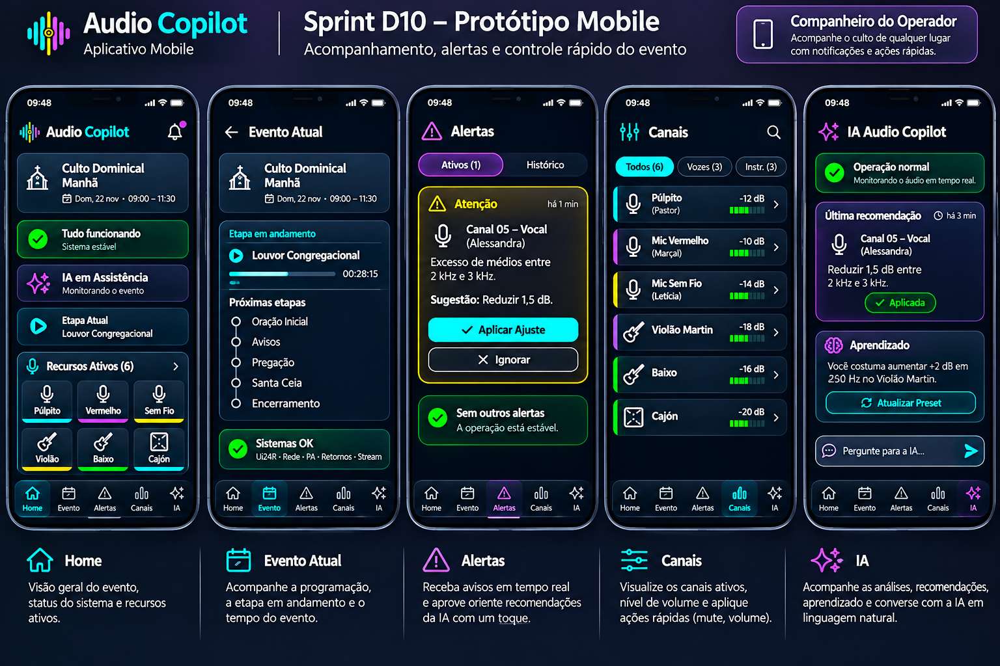

# Sprint D10 – Protótipo Mobile

## Objetivo

Definir a versão mobile do Audio Copilot, destinada ao acompanhamento do evento em tempo real.

O aplicativo móvel não substitui a interface principal do sistema.

Seu propósito é permitir que o operador acompanhe o culto de qualquer lugar da igreja, receba alertas importantes e execute ações rápidas sem precisar permanecer em frente ao computador.

O Mobile funciona como um **controle remoto inteligente** do Audio Copilot.

---

# Protótipo

## Versão 1

---

# Filosofia da Tela

Durante o culto, o operador raramente permanece ao lado da mesa de som.

Em diversos momentos ele precisa:

- caminhar pelo templo;
- conversar com os músicos;
- acompanhar o pregador;
- ouvir a sonoridade em diferentes locais;
- verificar o retorno de palco;
- auxiliar participantes.

Por esse motivo, o aplicativo mobile foi projetado para oferecer apenas as informações essenciais da operação.

O objetivo não é realizar configurações avançadas da mesa, mas fornecer mobilidade ao operador.

---

# Conceito

O aplicativo mobile atua como uma extensão do Audio Copilot.

Enquanto o computador permanece responsável pela operação completa da Ui24R, o celular permite:

- acompanhar o evento;
- visualizar alertas;
- consultar os canais ativos;
- aceitar ou rejeitar recomendações da IA;
- realizar pequenas ações operacionais.

Toda a configuração avançada continua sendo realizada na versão desktop.

---

# Estrutura do Aplicativo

O aplicativo é composto por cinco telas principais.

---

## Home

É a tela inicial do aplicativo.

Apresenta uma visão resumida do evento.

São exibidos:

- nome do evento;
- horário;
- status geral do sistema;
- modo da IA;
- etapa atual;
- quantidade de recursos ativos.

Exemplo:

- Culto Domingo Manhã;
- Tudo funcionando;
- IA em Assistência;
- Louvor Congregacional;
- 6 recursos ativos.

Esta tela permite ao operador verificar rapidamente se existe alguma situação que exige atenção.

---

## Evento Atual

Exibe o andamento do evento.

São apresentadas informações como:

- etapa atualmente em execução;
- tempo de evento;
- próximas etapas da Programação Técnica;
- status geral dos sistemas.

Exemplo:

Evento Atual:

- Louvor Congregacional

Próximas etapas:

- Oração Inicial;
- Avisos;
- Pregação;
- Encerramento.

Essa tela permite que o operador acompanhe o cronograma do culto sem consultar o computador.

---

## Alertas

Esta é a tela mais importante do aplicativo.

Sempre que a IA identificar uma situação relevante, um alerta será apresentado.

Exemplos:

- canal sem sinal;
- possível microfonia;
- clipping;
- nível elevado;
- equipamento desconectado.

Cada alerta informa:

- canal;
- participante;
- descrição do problema;
- sugestão da IA.

O operador poderá responder rapidamente através das opções:

- Aplicar;
- Ignorar.

---

## Canais

Apresenta apenas os canais ativos definidos para o evento.

Cada canal exibe:

- nome do recurso;
- participante;
- nível de sinal;
- estado atual.

Ao selecionar um canal, o operador poderá executar ações rápidas.

Exemplos:

- alterar volume;
- aplicar Mute;
- remover Mute;
- visualizar detalhes;
- abrir diretamente o Console de Operação no computador.

O aplicativo não permite alterar:

- EQ;
- Compressor;
- Gate;
- Auxiliares;
- FX.

Essas configurações permanecem exclusivas da interface desktop.

---

## IA

Apresenta um resumo da atuação da Inteligência Artificial.

São exibidos:

- estado atual da IA;
- última recomendação;
- histórico recente;
- aprendizados registrados.

Também existe um campo para perguntas em linguagem natural.

Exemplos:

- Por que reduziu o ganho?
- Qual canal está mais alto?
- Quem utiliza o Mic Vermelho?
- Qual preset está ativo?

A IA responde utilizando a Memória Operacional do sistema.

---

# Controle Rápido

O aplicativo permite executar pequenas ações durante a operação.

Exemplos:

- Mute;
- Unmute;
- ajuste simples de volume;
- aceitar recomendações da IA;
- ignorar recomendações.

O objetivo é resolver rapidamente pequenas situações sem necessidade de acessar o computador.

---

# Notificações Inteligentes

O aplicativo poderá enviar notificações em tempo real.

Exemplos:

"Feedback detectado no retorno."

"Mic Vermelho sem sinal."

"Canal 05 próximo do clipping."

"A IA recomenda reduzir 2 dB."

Ao tocar na notificação, o aplicativo abre diretamente o recurso relacionado.

---

# Fluxo de Utilização

O fluxo esperado é:

1. Abrir o aplicativo.
2. Confirmar o evento atual.
3. Acompanhar a etapa em execução.
4. Receber alertas em tempo real.
5. Executar ações rápidas quando necessário.
6. Retornar ao acompanhamento do evento.

---

# Regras de Negócio

O sistema deverá seguir as seguintes regras:

- Exibir apenas recursos ativos.
- Sincronizar todas as informações com o sistema principal.
- Atualizar dados em tempo real.
- Permitir apenas ações rápidas.
- Bloquear configurações avançadas da Ui24R.
- Exibir alertas prioritários.
- Registrar todas as ações realizadas pelo aplicativo.

---

# Integração com Outras Telas

Recebe informações de:

- Dashboard Principal;
- Configuração do Evento;
- Preparação do Evento;
- Console de Operação;
- Painel da IA.

Permite acesso rápido ao Console de Operação através de navegação contextual.

Toda ação realizada pelo aplicativo é sincronizada automaticamente com o sistema principal.

---

# Objetivos de UX

A interface deverá priorizar:

- simplicidade;
- mobilidade;
- rapidez;
- baixa carga cognitiva;
- poucas interações;
- foco em alertas;
- acompanhamento do evento;
- resposta rápida às recomendações da IA.

---

# Filosofia de Uso

O aplicativo mobile não foi criado para substituir o computador.

Sua função é acompanhar a operação enquanto o operador circula pela igreja.

O computador continua sendo o ambiente de configuração e operação completa da mesa.

O celular funciona como um controle remoto inteligente, permitindo monitorar o evento, responder rapidamente aos alertas da IA e executar pequenas ações sem interromper o trabalho do operador.

Essa separação reduz a complexidade da interface e torna a operação mais segura durante o culto.

---

# Melhorias Futuras

Funcionalidades previstas para versões futuras:

- notificações por smartwatch;
- comandos por voz;
- confirmação por biometria para ações críticas;
- widgets na tela inicial do celular;
- modo escuro e claro;
- suporte para tablets;
- visualização remota dos medidores da Ui24R;
- integração com dispositivos vestíveis.

---

# Situação da Sprint

**Status:** ✅ Concluída