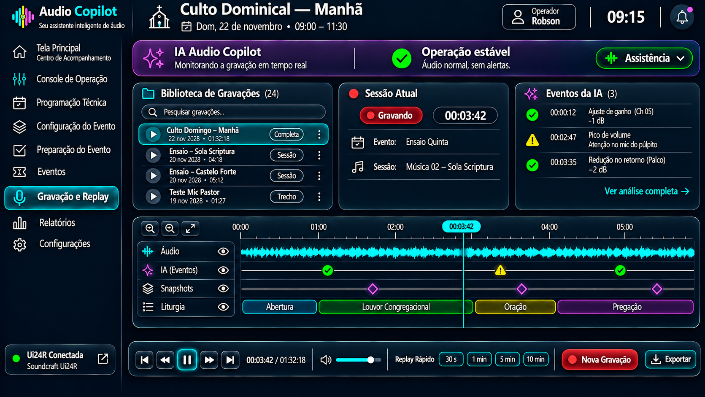

# Sprint D13 – Protótipo do Sistema de Gravação e Replay

## Objetivo

Definir a interface do Sistema de Gravação e Replay do Audio Copilot, responsável por registrar, reproduzir e analisar gravações realizadas durante ensaios, cultos e atividades técnicas.

O objetivo desta tela não é substituir um editor de áudio profissional, mas fornecer ao operador um ambiente simples e integrado para localizar rapidamente trechos importantes da gravação, revisar eventos da operação e documentar todo o histórico do evento.

O módulo também servirá como base para futuras funcionalidades de análise inteligente realizadas pela IA.

---

# Protótipo

## Versão 1

---

# Filosofia da Tela

Assim como as demais telas do Audio Copilot, o Sistema de Gravação e Replay foi projetado para manter baixa carga cognitiva durante a operação.

A prioridade da interface é facilitar o acesso às gravações e à linha do tempo do evento, evitando excesso de informações simultâneas.

A filosofia adotada é:

- interface limpa;
- foco na Timeline;
- navegação rápida;
- reprodução simples;
- integração com a IA;
- acesso imediato às gravações;
- baixa carga cognitiva.

---

# Conceito

O Sistema de Gravação e Replay funciona como uma biblioteca inteligente de gravações.

Seu objetivo é responder rapidamente às principais perguntas do operador:

- Qual gravação estou analisando?
- A gravação está em andamento?
- Em que momento ocorreu determinado evento?
- Quais recomendações a IA registrou?
- Posso reproduzir rapidamente um trecho específico?
- Posso iniciar uma nova gravação?

Toda a navegação foi organizada para que essas respostas estejam sempre visíveis sem exigir múltiplas telas.

---

# Estrutura da Tela

A interface é composta pelos seguintes blocos.

---

## Cabeçalho do Evento

Apresenta as principais informações do evento atualmente carregado.

São exibidos:

- nome do evento;
- data;
- horário;
- operador responsável;
- relógio do sistema.

---

## Painel da IA

O painel superior apresenta o estado atual da análise realizada pela Inteligência Artificial.

São exibidos:

- modo de operação;
- situação geral da gravação;
- existência de alertas.

Enquanto nenhuma anormalidade for identificada, apenas um resumo será apresentado.

---

## Biblioteca de Gravações

Apresenta todas as gravações disponíveis relacionadas aos eventos.

Cada gravação informa:

- nome da sessão;
- data;
- duração;
- tipo da gravação.

Exemplos:

- Culto Domingo — Manhã
- Ensaio — Sola Scriptura
- Ensaio — Castelo Forte
- Teste Mic Pastor

Cada item possui um identificador visual indicando sua categoria.

Exemplos:

- Completa
- Sessão
- Trecho

A biblioteca também oferece pesquisa rápida para localização das gravações.

---

## Sessão Atual

Exibe um resumo da gravação atualmente aberta.

São apresentados:

- status da gravação;
- tempo decorrido;
- evento;
- nome da sessão.

Exemplo:

Evento:

- Ensaio Quinta

Sessão:

- Música 02 — Sola Scriptura

Caso exista uma gravação em andamento, o indicador "Gravando" permanecerá visível.

---

## Eventos da IA

Apresenta apenas os eventos relevantes detectados durante a gravação.

Exemplos:

- ajuste automático de ganho;
- pico de volume;
- redução de retorno;
- clipping;
- início de microfonia.

Cada evento permanece sincronizado com a Timeline.

Ao selecionar um evento, a reprodução será posicionada automaticamente no instante correspondente.

---

## Timeline Inteligente

Este é o principal componente da tela.

A Timeline apresenta toda a gravação sincronizada com as informações produzidas pelo Audio Copilot.

São exibidas diferentes trilhas, como:

- Áudio;
- Eventos da IA;
- Snapshots;
- Liturgia.

Cada trilha pode ser exibida ou ocultada individualmente.

O operador pode navegar livremente pela gravação utilizando a linha do tempo.

---

## Player

Na parte inferior da tela ficam concentrados todos os controles de reprodução.

São disponibilizados:

- voltar;
- reproduzir;
- pausar;
- avançar;
- posição atual;
- controle de volume.

Também são disponibilizados atalhos de Replay Rápido:

- 30 segundos;
- 1 minuto;
- 5 minutos;
- 10 minutos.

---

## Nova Gravação

A criação de novas gravações é realizada através do botão **Nova Gravação**, localizado na barra inferior.

Ao selecioná-lo, o sistema apresentará um diálogo permitindo escolher o tipo de gravação desejado.

As opções previstas são:

- Gravação Completa;
- Nova Sessão;
- Gravar Trecho;
- Replay Buffer.

Essa escolha ocorre apenas no momento da criação da gravação, mantendo a interface principal limpa e objetiva.

---

## Exportação

O botão Exportar permite salvar a gravação ou trechos selecionados em formatos compatíveis para arquivamento ou compartilhamento.

Em versões futuras também permitirá exportação juntamente com os eventos registrados pela IA.

---

# Navegação

A partir desta tela o operador poderá acessar:

- Eventos;
- Relatórios;
- Console de Operação;
- Configurações.

Também será possível navegar diretamente para um instante específico da Timeline através dos Eventos da IA.

---

# Fluxo de Utilização

O fluxo esperado é:

1. Abrir o Sistema de Gravação e Replay.
2. Selecionar uma gravação existente ou iniciar uma nova.
3. Navegar pela Timeline.
4. Localizar eventos importantes.
5. Reproduzir o trecho desejado.
6. Utilizar Replay Rápido quando necessário.
7. Exportar a gravação ou um trecho específico.

---

# Regras de Negócio

O sistema deverá seguir as seguintes regras:

- Exibir apenas gravações disponíveis para o operador.
- Atualizar automaticamente a duração da gravação em andamento.
- Sincronizar a Timeline com os eventos registrados pela IA.
- Permitir ocultar ou exibir trilhas da Timeline.
- Posicionar automaticamente a reprodução ao selecionar um evento.
- Manter sincronização entre gravações, snapshots e liturgia.
- Exibir o diálogo de seleção apenas ao iniciar uma nova gravação.

---

# Integração com Outras Telas

Recebe informações de:

- Eventos;
- Programação Técnica;
- Console de Operação;
- IA Audio Copilot.

Permite navegação para:

- Relatórios;
- Eventos;
- Console de Operação.

Também servirá como base para futuras funcionalidades de comparação de gravações e análise inteligente.

---

# Objetivos de UX

A interface deverá priorizar:

- simplicidade;
- foco na Timeline;
- baixa carga cognitiva;
- navegação intuitiva;
- acesso rápido às gravações;
- integração visual com as demais telas;
- reprodução imediata;
- consistência com a identidade do Audio Copilot.

---

# Melhorias Futuras

Funcionalidades previstas para versões futuras:

- comparação entre duas gravações;
- gravação multicanal;
- transcrição automática por IA;
- geração automática de marcadores;
- comparação entre ensaio e culto;
- busca inteligente por palavras ou eventos;
- comentários colaborativos;
- sincronização com vídeo.

---

# Situação da Sprint

**Status:** ✅ Concluída