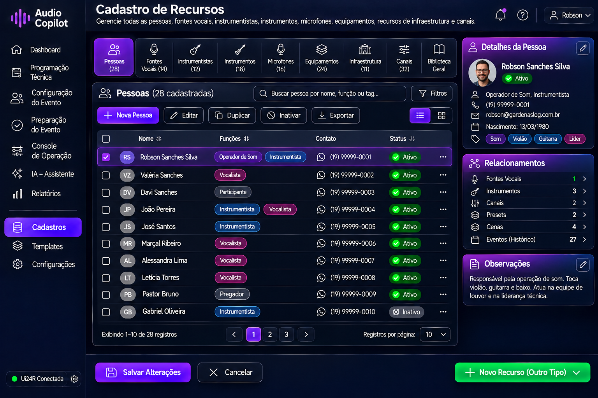

# Sprint E14 - Protótipo do Cadastro de Recursos

## Objetivo

Definir a interface responsável pelo gerenciamento de todos os recursos cadastrados no Audio Copilot, permitindo ao operador administrar pessoas, fontes vocais, instrumentistas, instrumentos, microfones, equipamentos, recursos de infraestrutura, canais e demais elementos utilizados durante a preparação e operação dos eventos.

O objetivo desta tela é centralizar todos os cadastros do sistema em um único ambiente, padronizando a experiência do usuário e facilitando a administração da base de dados.

---

# Evolução do Conceito

Durante a modelagem desta sprint foi identificado que praticamente todos os módulos do Audio Copilot dependem de informações previamente cadastradas.

Por esse motivo, optou-se por criar um Centro de Cadastros unificado, evitando telas independentes para cada tipo de recurso.

Isso proporciona uma navegação mais simples, reduz a curva de aprendizado e mantém uma identidade visual consistente em todo o sistema.

---

# Protótipo

## Versão 1

---

# Conceito da Tela

O Cadastro de Recursos funciona como a porta de entrada para toda a configuração do Audio Copilot.

É nesta interface que serão cadastrados todos os elementos utilizados posteriormente nas etapas de:

- Programação Técnica;
- Configuração do Evento;
- Preparação do Evento;
- Operação ao Vivo;
- Inteligência Artificial;
- Relatórios.

Todo recurso cadastrado poderá ser reutilizado em diferentes eventos, evitando retrabalho e garantindo padronização.

---

# Estrutura da Tela

A interface é composta pelas seguintes áreas.

## Barra Superior

Apresenta informações gerais da área de cadastro.

- Título da tela;
- Descrição do módulo;
- Notificações;
- Usuário logado.

---

## Menu Lateral

Permite navegar entre os principais módulos do sistema.

Exemplos:

- Dashboard;
- Programação Técnica;
- Configuração do Evento;
- Preparação do Evento;
- Console de Operação;
- IA Assistente;
- Relatórios;
- Cadastros;
- Templates;
- Configurações.

---

## Seletor de Categorias

Permite alternar rapidamente entre os diversos cadastros disponíveis.

Exemplos:

- Pessoas;
- Fontes Vocais;
- Instrumentistas;
- Instrumentos;
- Microfones;
- Equipamentos;
- Recursos de Infraestrutura;
- Canais;
- Biblioteca Geral.

Cada categoria apresenta a quantidade de registros cadastrados.

---

## Barra de Pesquisa

Permite localizar rapidamente qualquer recurso.

A pesquisa poderá ser realizada por:

- Nome;
- Função;
- Instrumento;
- Fabricante;
- Modelo;
- Canal;
- Tag;
- Palavra-chave.

---

## Barra de Ferramentas

Disponibiliza as principais operações.

Exemplos:

- Novo Cadastro;
- Editar;
- Duplicar;
- Inativar;
- Exportar.

---

## Lista de Recursos

Área principal da interface.

Exibe todos os registros pertencentes à categoria selecionada.

Cada linha apresenta informações resumidas do recurso.

Exemplo para Pessoas:

- Nome;
- Funções;
- Contato;
- Situação;
- Menu de ações.

---

## Painel de Detalhes

Ao selecionar um recurso, a lateral direita apresenta suas informações completas.

Exemplo:

- Foto;
- Nome;
- Situação;
- Contatos;
- Funções;
- Etiquetas;
- Informações principais.

---

## Painel de Relacionamentos

Apresenta todas as ligações existentes entre o recurso selecionado e os demais módulos.

Exemplos:

- Fontes Vocais;
- Instrumentos;
- Microfones;
- Equipamentos;
- Canais;
- Presets;
- Cenas;
- Eventos.

Essa visualização permite compreender rapidamente como determinado recurso está sendo utilizado dentro do sistema.

---

## Painel de Observações

Área destinada ao registro de informações livres.

Exemplos:

- Preferências do operador;
- Observações técnicas;
- Características específicas;
- Recomendações.

---

## Barra Inferior

Disponibiliza as principais ações da tela.

Exemplos:

- Salvar Alterações;
- Cancelar;
- Novo Recurso.

---

# Fluxo Operacional

O fluxo de utilização da tela foi definido da seguinte forma.

1. Selecionar a categoria desejada.
2. Localizar um recurso existente ou criar um novo.
3. Preencher as informações necessárias.
4. Associar relacionamentos quando aplicável.
5. Salvar o cadastro.
6. Disponibilizar automaticamente o recurso para utilização em todo o sistema.

---

# Recursos Identificados

Durante esta sprint foram definidos os principais grupos de recursos.

## Pessoas

Cadastro básico de participantes.

---

## Fontes Vocais

Perfis vocais utilizados pelo sistema.

Exemplos:

- Vocal Masculino;
- Vocal Feminino;
- Pregador;
- Dirigente;
- Leitor.

---

## Instrumentistas

Pessoas que executam instrumentos musicais.

---

## Instrumentos

Instrumentos físicos cadastrados.

Exemplos:

- Violão;
- Guitarra;
- Baixo;
- Piano;
- Cajón.

---

## Microfones

Cadastro individual dos microfones disponíveis.

---

## Equipamentos

Equipamentos auxiliares utilizados durante os eventos.

Exemplos:

- DI Box;
- Pedaleiras;
- Monitores;
- Sistemas sem fio;
- Interfaces.

---

## Recursos de Infraestrutura

Recursos físicos disponíveis no templo.

Exemplos:

- Púlpito;
- PA Principal;
- Monitores;
- Projetores;
- Telões.

---

## Canais

Mapeamento lógico dos canais utilizados pelo Audio Copilot.

---

## Biblioteca Geral

Consulta integrada de todos os recursos cadastrados.

---

# Filosofia do Cadastro

O Cadastro de Recursos foi concebido para ser a base de conhecimento permanente do Audio Copilot.

Todos os demais módulos consomem informações provenientes desta tela.

Por esse motivo, o sistema evita duplicidade de informações e incentiva o reaproveitamento dos cadastros existentes.

Cada recurso passa a existir apenas uma vez e pode ser reutilizado em qualquer evento.

---

# Objetivos de UX

A interface deverá priorizar:

- organização dos cadastros;
- rapidez na localização de recursos;
- padronização visual;
- pesquisa global;
- baixa carga cognitiva;
- poucos cliques para cadastro;
- visualização imediata dos relacionamentos;
- facilidade de manutenção;
- integração com a Inteligência Artificial.

---

# Integração com a IA

A Inteligência Artificial utilizará os dados cadastrados para:

- sugerir presets;
- recomendar canais;
- identificar recursos ausentes;
- detectar inconsistências;
- sugerir equipamentos compatíveis;
- automatizar configurações;
- gerar recomendações durante os eventos.

---

# Conclusão da Sprint

A Sprint E14 definiu a interface do Centro de Cadastros do Audio Copilot, estabelecendo um ambiente único para gerenciamento de todos os recursos utilizados pelo sistema.

Essa centralização simplifica a administração das informações, melhora a experiência do usuário e fornece uma base consistente para a automação dos processos, para a operação ao vivo e para a atuação da Inteligência Artificial.

---

# Situação da Sprint

**Status:** ✅ Concluída